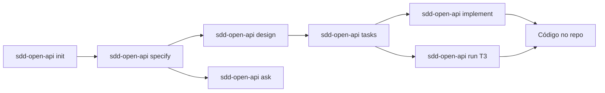

# sdd-open-api

**Spec-driven development no terminal — com qualquer LLM compatível com OpenAI.**

`sdd-open-api` (*TUI Spec-Driven Development — Open API*) é uma CLI Go com dashboard full-screen estilo **k9s**. Ela guia você do requisito ao código usando um fluxo estruturado e artefatos rastreáveis em `.specs/`.

> Ideia → spec → design → tasks → implementação — tudo no mesmo lugar, com tokens e metadados na tela.

```bash
git clone https://github.com/pedrobelmino/tui-sdd-open-api.git
cd tui-sdd-open-api
make build          # instala em ~/.local/bin/sdd-open-api
sdd-open-api doctor         # health check
sdd-open-api                # abre o dashboard (pede API key na primeira vez)
```

---

## Por que sdd-open-api?

Desenvolvimento assistido por IA costuma ser ad hoc: sem specs, sem memória entre sessões, sem visão do consumo de recursos, e sem fluxo claro do requisito à implementação.

**sdd-open-api resolve isso com:**

| | |
|---|---|
| **Fluxo guiado** | `init` → `specify` → `design` → `tasks` → `implement` / `run` |
| **Múltiplos providers** | Ollama (local), DeepSeek, OpenRouter.ai ou qualquer API compatível com OpenAI |
| **Dashboard k9s-like** | Tokens, modelo, tamanho do terminal e features num terminal interativo |
| **Rastreabilidade** | Requisitos com ID, tarefas com critérios, decisões em `STATE.md` |
| **Tool loop inteligente** | O modelo lê/escreve arquivos com guardrails para modelos pequenos |
| **Ask mode** | Perguntas read-only sobre spec/design/tasks sem tocar no código |

Funciona como **complemento** ao Cursor/IDE — não substitui — mas dá estrutura e visibilidade que um chat genérico não oferece.

---

## Provedores LLM

O `sdd-open-api` funciona com **qualquer API compatível com OpenAI** — você escolhe na configuração.

| Provedor | Provider | API Key | Exemplo de modelo |
|---|---|---|---|
| **[Ollama](https://ollama.com)** (local) | `ollama` | Não precisa | `qwen2.5-coder:3b` |
| **[DeepSeek](https://deepseek.com)** | `openapi` | ✓ | `deepseek-v4-flash` |
| **[OpenRouter.ai](https://openrouter.ai)** | `openapi` | ✓ | `anthropic/claude-3.5-sonnet` |
| Qualquer API OpenAI-compatible | `openapi` | ✓ | qualquer slug |

Ao usar `openapi`, o `sdd-open-api` pergunta a **API key** na abertura da TUI e oferece:
- **`s`** — apenas na sessão atual
- **`p`** — persistir em `~/.sdd-open-api/config.yaml`

Em seguida, você escolhe o modelo entre as opções configuradas.

---

## Demo do fluxo



**Exemplo completo** (projeto novo):

```bash
mkdir meu-app && cd meu-app
sdd-open-api init                          # cria .specs/project/
sdd-open-api specify landing-page --brief "Página inicial com header e footer"
sdd-open-api design landing-page           # design.md (opcional, features médias+)
sdd-open-api tasks landing-page            # tasks.md com T1, T2, …
sdd-open-api implement landing-page        # implementa todas as tarefas pendentes
# ou, tarefa a tarefa (recomendado com modelos 3B):
sdd-open-api run landing-page --task T3
```

Durante `implement` / `run`, o modelo usa ferramentas de arquivo (`read_file`, `write_file`, `list_dir`, …) num loop supervisionado — você vê cada passo na TUI ou no stdout.

Logs de implementação mostram explicitamente o contexto carregado:

```
📚 contexto considerado: spec.md (3120 chars) · design.md (1840 chars) · tasks.md (2100 chars)
🧱 stack do projeto (autoritativa): React/JS
```

---

## Dashboard TUI

Abra sem argumentos:

```bash
sdd-open-api
```

### Views

| Tecla | View |
|-------|------|
| `1` | **Overview** — visão geral do projeto |
| `2` | **Features** — specs, design, tasks, implement |
| `3` | **Models** — modelo configurado |
| `4` | **Metrics** — tokens consumidos e metadados da sessão |
| `5` | **System** — CPU, RAM, disco, load |

### Features (view `2`)

| Tecla | Ação |
|-------|------|
| `n` | Nova feature (nome + brief → gera spec) |
| `s` | Specify — gerar/atualizar `spec.md` |
| `d` | Design — gerar `design.md` |
| `t` | Tasks — gerar `tasks.md` |
| `p` | **Ask** — perguntas read-only sobre a feature |
| `e` | Implement — implementar feature inteira |
| `w` | Quick task — pedido ad-hoc |
| `enter` | Abrir detalhe da feature |

### Detalhe da feature

| Tecla | Ação |
|-------|------|
| `j` / `k` | Navegar tarefas |
| `e` / `enter` | Executar tarefa selecionada |
| `a` | Implement all — todas as tarefas pendentes |
| `p` | Ask sobre a feature |
| `y` | **Copiar log completo** para clipboard (fallback: `~/.sdd-open-api/last-action.log`) |
| `x` / `esc` | **Cancelar** ação em andamento |

Pressione `?` a qualquer momento para ver todos os atalhos.

---

## Comandos CLI

Todos os subcomandos funcionam fora da TUI — úteis para scripts e automação.

| Comando | Descrição |
|---------|-----------|
| `sdd-open-api` | Dashboard interativo |
| `sdd-open-api init` | Cria `.specs/project/` (PROJECT, ROADMAP, STATE) |
| `sdd-open-api specify <feature> --brief "…"` | Gera `spec.md` com requisitos rastreáveis |
| `sdd-open-api design <feature>` | Gera `design.md` |
| `sdd-open-api tasks <feature>` | Quebra em tarefas atômicas com critérios de verificação |
| `sdd-open-api implement <feature>` | Implementa tarefas pendentes via tool loop |
| `sdd-open-api run <feature> --task T3` | Executa uma tarefa específica |
| `sdd-open-api ask <feature> --question "…"` | Q&A read-only (spec + design + tasks) |
| `sdd-open-api validate [feature]` | Valida completude de spec/tasks |
| `sdd-open-api doctor` | Health check: provedor, modelo, GPU, `.specs/` |

---

## Requisitos

- **Linux** (v1 — sem macOS/Windows por enquanto)
- **Go 1.22+** (build)
- **Ollama** (se usar provider `ollama`) ou **API key** (se usar `openapi`)
- Terminal ANSI, mínimo **80×24**
- GPU **AMD** ou **NVIDIA** (opcional — métricas degradam graciosamente)

---

## Instalação

### 1. Build

```bash
git clone https://github.com/pedrobelmino/tui-sdd-open-api.git
cd tui-sdd-open-api
make build
# binário em bin/sdd-open-api e copiado para ~/.local/bin/sdd-open-api
```

Certifique-se de que `~/.local/bin` está no `PATH`.

### 2. Configurar provedor

#### Opção A — Ollama (local)

```bash
curl -fsSL https://ollama.com/install.sh | sh
sudo systemctl enable --now ollama
ollama pull qwen2.5-coder:3b
```

```yaml
# ~/.sdd-open-api/config.yaml
provider: ollama
model: qwen2.5-coder:3b
ollama_host: http://127.0.0.1:11434
```

#### Opção B — Open API (DeepSeek, OpenRouter, etc.)

```yaml
# ~/.sdd-open-api/config.yaml
provider: openapi
model: deepseek-v4-flash            # ou deepseek-v4-pro
api_host: https://api.deepseek.com   # DeepSeek
# api_host: https://openrouter.ai/api/v1  # OpenRouter
```

A API key é solicitada na abertura da TUI. Você também pode definir via env:

```bash
export TSLL_API_KEY="sk-..."
export TSLL_API_HOST="https://api.deepseek.com"
sdd-open-api
```

### 3. Verificar

```bash
sdd-open-api doctor
```

Saída esperada:

```
✓ DeepSeek API reachable
✓ model deepseek-v4-flash configured
✓ GPU [amd] … — util X% VRAM X/X MiB
✓ .specs/project at /caminho/do/projeto
```

---

## Configuração

**Global:** `~/.sdd-open-api/config.yaml`

```yaml
provider: openapi              # ollama | openapi
model: deepseek-v4-flash       # deepseek-v4-flash, deepseek-v4-pro, ou slug do modelo
api_host: https://api.deepseek.com  # URL base compatível com OpenAI
api_key: ""                    # key é solicitada na TUI, ou use TSLL_API_KEY env
ollama_host: http://127.0.0.1:11434  # só usado com provider: ollama
gpu_prefer: amd                # amd | nvidia | auto
theme: k9s
fast_mode: false               # false = contexto completo de spec/design/tasks
```

**Por projeto:** `.sdd-open-apirc` no diretório do repo.

| Variável | Efeito |
|----------|--------|
| `OLLAMA_HOST` | URL do Ollama |
| `TSLL_MODEL` | Override do modelo |
| `TSLL_PROVIDER` | `ollama` ou `openapi` |
| `TSLL_API_KEY` | API key para Open API (DeepSeek, OpenRouter, etc.) |
| `TSLL_API_HOST` | URL base para Open API |
| `TSLL_GPU_PREFER` | `amd` ou `nvidia` |
| `TSLL_FAST=1` | Liga fast mode (trunca spec/design/tasks — mais rápido, pior para implement) |
| `TSLL_TUI=0` | `sdd-open-api` sem args não abre TUI |
| `NO_COLOR` | Saída sem cores |

---

## Modelos recomendados

### GPU modesta (~4 GB VRAM) — via Ollama

| Modelo | VRAM ~ | Uso |
|--------|--------|-----|
| `qwen2.5-coder:3b` | ~2 GB | **Recomendado** — cabe na VRAM com folga para contexto e `<file_plan>` |
| `qwen2.5-coder:3b-instruct-q4_K_M` | ~2 GB | Variante instruct — melhor para seguir formato de resposta |
| `deepseek-coder:6.7b-instruct-q3_K_M` | ~3,3 GB | Mais capaz, mas apertado em 4 GB — pode offload parcial para CPU |

Evite quantizações Q8 ou modelos 7B+ em GPUs de 4 GB: ocupam quase toda a VRAM e pioram o loop de implementação.

### GPUs com mais VRAM — via Ollama

| Modelo | VRAM ~ | Uso |
|--------|--------|-----|
| `qwen2.5-coder:7b` | ~5 GB | Melhor qualidade de código |
| `qwen2.5-coder:14b` | ~9 GB | Implementações mais assertivas |

### API remota — DeepSeek / OpenRouter

| Provedor | Modelo | Custo aprox. |
|----------|--------|-------------|
| **[DeepSeek](https://api.deepseek.com)** | `deepseek-v4-flash` | Muito baixo |
| **[DeepSeek](https://api.deepseek.com)** | `deepseek-v4-pro` | Baixo |
| **[OpenRouter.ai](https://openrouter.ai)** | `openai/gpt-4o`, `anthropic/claude-3.5-sonnet`, `google/gemini-2.0-flash`, etc. | Variável |

**Dica:** OpenRouter permite acessar dezenas de modelos com uma única chave — ótimo para comparar provedores sem trocar de config.

### Dicas para modelos pequenos (3B)

Com modelos **3B**, prefira **`sdd-open-api run <feature> --task Tn`** (uma tarefa por vez) em vez de `implement` completo. Use **`fast_mode: false`** em `~/.sdd-open-api/config.yaml` — o contexto completo de `spec.md`, `design.md` e `tasks.md` ajuda o modelo a montar o `<file_plan>`.

O tool loop tem guardrails para modelos pequenos:

- Bootstrap do layout do projeto antes do primeiro turno
- `<file_plan>` derivado de **tasks.md** + spec/design (plano flexível — arquivos de integração extras permitidos dentro do escopo da tarefa)
- Allowlist por seção (header, product, contact…) — evita reescrever partes erradas da app
- Auto-conclusão quando todos os arquivos planejados foram escritos
- Fail-fast em erros repetidos e parsing tolerante de JSON malformado
- Bloqueio de escrita em `.specs/` (gerenciado pelo sdd-open-api, não pelo modelo)

---

## Estrutura `.specs/`

O projeto segue as convenções da skill **[tlc-spec-driven](https://github.com/tech-leads-club/agent-skills)** (Tech Lead's Club):

```
.specs/
├── project/
│   ├── PROJECT.md      # visão, stack, escopo
│   ├── ROADMAP.md      # milestones
│   └── STATE.md        # decisões, blockers, memória entre sessões
├── codebase/           # brownfield mapping (arquitetura, convenções, testes…)
└── features/
    └── minha-feature/
        ├── spec.md     # requisitos com IDs
        ├── design.md   # decisões técnicas (opcional)
        └── tasks.md    # tarefas T1, T2… com critérios
```

O `implement` respeita a **stack definida em `PROJECT.md`** — mesmo que `design.md` mencione outra tecnologia, a implementação segue o que está no projeto.

---

## Como funciona por baixo

```
┌─────────────┐     ┌──────────────┐     ┌──────────────────────┐
│  Bubble Tea │────▶│   workflow   │────▶│    LLM Provider      │
│  TUI k9s    │     │ specify/tasks│     │                      │
└─────────────┘     │ implement    │     │ Ollama (local)       │
                    └──────┬───────┘     │ DeepSeek (remoto)    │
                           │             │ OpenRouter (remoto)  │
                    ┌──────▼───────┐     │ OpenAI-compatível    │
                    │  file tools  │     └──────────────────────┘
                    │ read/write/  │
                    │ list/create  │
                    └──────────────┘
```

- **Go 1.22** + Cobra (CLI) + Bubble Tea / lipgloss (TUI)
- **OpenAI-compatible HTTP API** com streaming e contagem de tokens
- **GPU metrics:** AMD (`amdgpu` + `rocm-smi`) e NVIDIA (`nvidia-smi`)
- **Host metrics:** `/proc` (CPU, RAM, swap) + `statfs` (disco)
- **Tool loop:** o modelo emite `<file_plan>` (paths da tarefa) e depois `<tool_call>{"tool":"write_file",…}</tool_call>`; o runtime executa, retorna resultado, e continua até concluir ou atingir limite
- **Implementação:** segue `tasks.md` (plano por tarefa), `spec.md` e `design.md`; a stack em `PROJECT.md` é autoritativa

---

## Desenvolvimento

```bash
make test                    # go test ./...
make build                   # bin/sdd-open-api → ~/.local/bin/sdd-open-api
go test ./internal/tui/ -v   # testes da TUI
go test ./internal/ollama/ -v # parser de tool calls, loop
```

Guia para contribuidores e agentes de IA: [`AGENTS.md`](AGENTS.md)

Documentação de arquitetura do próprio projeto: `.specs/codebase/`

---

## Roadmap (v1)

**Incluído:**

- Dashboard TUI com métricas de tokens, modelo e sistema
- Fluxo completo: init → specify → design → tasks → implement / run
- Ask mode (read-only Q&A sobre features)
- Tool loop com guardrails para modelos pequenos (plano flexível, escopo por tarefa, auto-complete)
- Cancelamento de ações (`x` / `esc`) e cópia de log (`y`)
- Suporte a múltiplos provedores: Ollama, DeepSeek, OpenRouter, qualquer API OpenAI-compatível
- Onboarding com API key (sessão ou persistente) e seleção de modelo
- `doctor` e `validate`
- Integração com convenções `tlc-spec-driven`

**Fora de escopo (v1):**

- Interface web/desktop
- macOS / Windows
- Multi-agente paralelo
- Deploy / CI/CD

---

## Agradecimentos

Este projeto implementa o workflow da skill **[tlc-spec-driven](https://github.com/tech-leads-club/agent-skills/blob/main/packages/skills-catalog/skills/(development)/tlc-spec-driven/SKILL.md)** do [Tech Lead's Club](https://github.com/tech-leads-club/agent-skills), por Felipe Rodrigues ([@felipfr](https://github.com/felipfr)).

A estrutura `.specs/`, as fases **Specify → Design → Tasks → Execute** e os artefatos de brownfield mapping seguem as convenções documentadas na skill. Obrigado ao projeto open source por definir um fluxo claro e reutilizável para spec-driven development.

Skill `tlc-spec-driven`: [CC-BY-4.0](https://creativecommons.org/licenses/by/4.0/).

---

## Contribuindo

Issues e PRs são bem-vindos. Antes de abrir um PR:

1. `make test` passa
2. Mudanças focadas — sem refactors não relacionados
3. Para features novas, considere atualizar `.specs/features/` ou `AGENTS.md`

---

<p align="center">
  <strong>Feito para devs solo que querem estrutura, visibilidade e liberdade de escolha de modelo.</strong><br>
  <code>sdd-open-api</code> — do spec ao código, no terminal.
</p>
